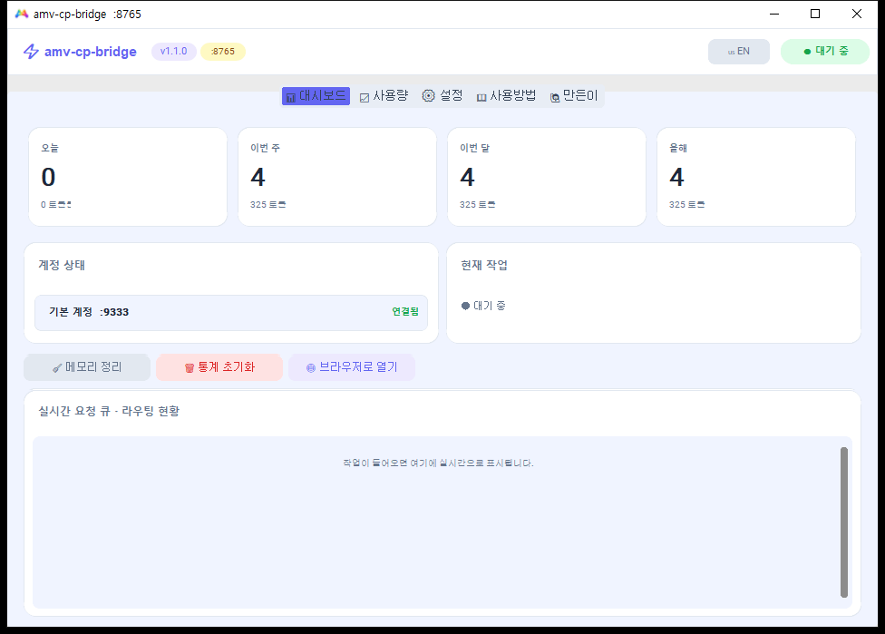
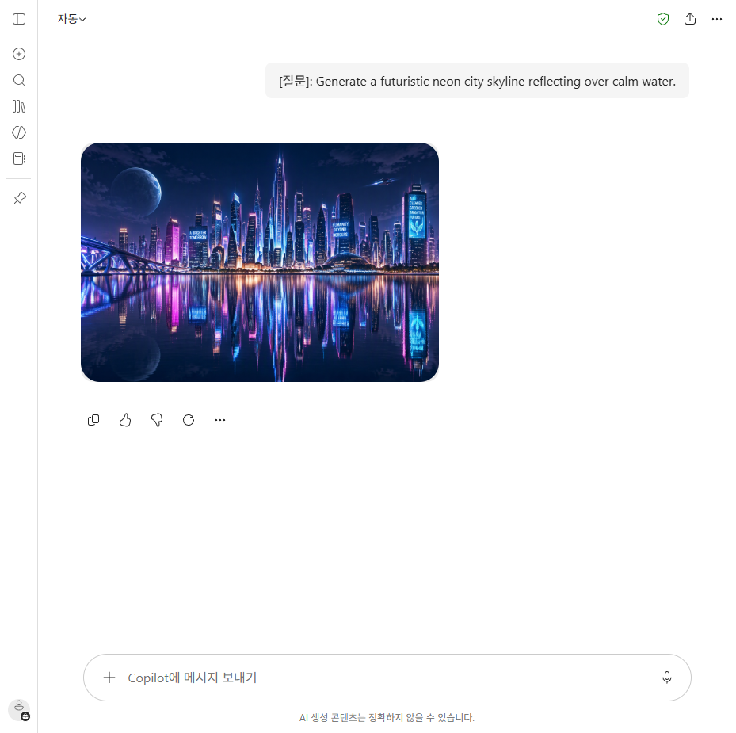
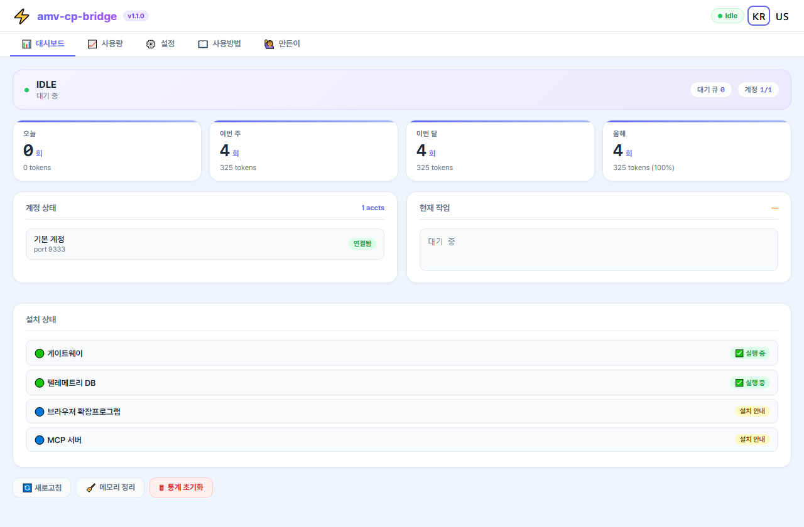
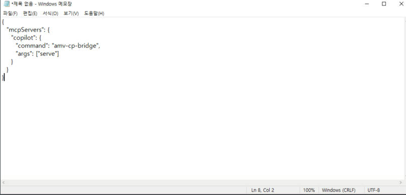

<div align="center">

# amv-cp-bridge

**Local OpenAI-compatible REST API (`:11500`), FastMCP stdio server, desktop GUI, and browser sidebar bridge for Microsoft 365 Copilot (Enterprise / Education).**

[FOR_AI_README (Autonomous Agent Setup & Operating Manual)](FOR_AI_README.md) · [CHANGELOG](CHANGELOG.md) · [Releases](https://github.com/uno-km/amv-cp-bridge/releases)

<p>
  
  
  
  
  
  
</p>

</div>

---

> **Want an AI coding agent to install and wire this up for you?**
> Paste `https://github.com/uno-km/amv-cp-bridge` into Claude Code, Cursor, Antigravity, Windsurf, or Codex and ask it to follow **[FOR_AI_README.md](FOR_AI_README.md)**. It provides a complete zero-to-working installation, MCP setup, verification, and troubleshooting playbook.

---

## Overview

`amv-cp-bridge` connects your existing Microsoft 365 Copilot (Enterprise or Education) web session(s) to local developer tools over loopback (`http://127.0.0.1:11500`).

- **OpenAI-Compatible REST API**: Serves `/v1/chat/completions` (streaming SSE & JSON), `/v1/images/generations`, and `/v1/models`, including multimodal vision/file attachments and structured reasoning output.
- **Multi-Account Pool & Strict FIFO Queue**: Supports multiple isolated M365 accounts (`9333+`), dispatches simultaneous bursts across distinct idle workers, and orders excess concurrency via a strict FIFO ticket queue with separated `queued` and `running` metrics.
- **Low-Footprint Browser Lifecycle**: Supports both `cold` (terminates Edge process tree after each query) and `hot` (configurable standby timer with 15-request renderer tab recycling). Prevents Chromium session-restore bloat (`restore_on_startup=5`, stale `Tabs_*`/`Session_*` pruning while preserving cookies) and trims extra tabs to a single page.
- **Local-First & Coexistence**: All session cookies, settings, and SQLite WAL telemetry stay under `~/.amv_cp_bridge/`. Runs cleanly alongside [`amv-gn-bridge`](https://github.com/uno-km/amv-gn-bridge) (`:11501` / CDP `9337+`) without port or profile conflicts.

<p align="center">
  
  <br>
  <em>Native Desktop GUI — Dashboard View</em>
</p>

---

## Verified Live Capabilities

| Capability | Verified Behavior |
| :--- | :--- |
| **Copilot Designer Image Generation** | Generates high-resolution images via `/v1/images/generations` or Markdown tags in `/v1/chat/completions`, with reference-image SHA-256/dimension filtering. <br/> |
| **Multimodal Vision & File Analysis** | Accepts base64 `image_url` data URIs or local `file_path` items, attaches via Playwright CDP, and cleans up temporary uploads automatically. <br/> |
| **Entra ID Fast-Fail & HTTP 401 Mapping** | Detects expired M365 / Entra ID redirects within ~1.5s, returns OpenAI-standard `401 Unauthorized` (`session_expired`), and dispatches an OS tray notification. |

---

## Prerequisites

- **Microsoft Edge** installed locally (Windows built-in; macOS: `brew install --cask microsoft-edge`). The bridge connects to your installed browser over CDP—do **not** run `playwright install`.
- A **Microsoft 365 Copilot** license (Enterprise or Education).
- For source installs: **Python 3.10+** (not required when using the Windows single-file EXE).

---

## Quick Start

All shell commands below are single-line commands joined with `&&` so a subsequent step does not execute if an earlier step fails.

### Option 1: One-Line Installer (Recommended)

**Windows (PowerShell or cmd)**

```powershell
powershell -NoProfile -ExecutionPolicy Bypass -Command "irm https://raw.githubusercontent.com/uno-km/amv-cp-bridge/master/scripts/setup_all.ps1 | iex"
```

> **Note on Windows Defender:** Some Defender configurations flag `irm ... | iex` command lines heuristically. If blocked, do not disable Defender; download `amv-cp-bridge.exe` directly from [GitHub Releases](https://github.com/uno-km/amv-cp-bridge/releases/latest) instead.

**macOS (Terminal)**

```bash
bash -c "$(curl -fsSL https://raw.githubusercontent.com/uno-km/amv-cp-bridge/master/scripts/setup_all.sh)"
```

### Option 2: Direct Windows EXE

Download `amv-cp-bridge.exe` from [GitHub Releases](https://github.com/uno-km/amv-cp-bridge/releases/latest) and run it directly. The native GUI and `:11500` gateway start together.

### Option 3: Install from Source

**Windows (PowerShell / cmd)**

```
cmd /c "git clone https://github.com/uno-km/amv-cp-bridge.git && cd amv-cp-bridge && pip install -e . && amv-cp-bridge dashboard"
```

**macOS / Linux (Bash)**

```bash
git clone https://github.com/uno-km/amv-cp-bridge.git && cd amv-cp-bridge && pip install -e . && amv-cp-bridge dashboard
```

**Windows helper batch files (`scripts/windows/`)** — double-click in Explorer:

| File | Action |
| :--- | :--- |
| `1_install.bat` | Verify Python and install dependencies |
| `2_dashboard.bat` | Start gateway + dashboard |
| `3_gateway.bat` | Start headless REST API gateway only |
| `4_purge.bat` | Terminate stale Edge CDP process trees |

---

## First-Run Account Sign-In

1. Open the native GUI or browse to `http://127.0.0.1:11500/dashboard`.
2. Click **Connect Account** (or call `POST /api/accounts/9333/login`).
3. Sign in to Microsoft 365 Copilot in the isolated Edge profile window that opens. Your daily Edge browser and profile remain untouched.

<p align="center">
  
  <br>
  <em>Web Dashboard — Live Account Status, Queue & Telemetry</em>
</p>

---

## Usage

### OpenAI-Compatible REST API (`http://127.0.0.1:11500`)

**macOS / Linux / Git Bash**

```bash
curl -N http://127.0.0.1:11500/v1/chat/completions -H "Content-Type: application/json" -d '{"model":"gpt-5.6-sol","messages":[{"role":"user","content":"Hello"}],"stream":true}'
```

**Windows PowerShell**

```powershell
irm http://127.0.0.1:11500/v1/chat/completions -Method Post -ContentType application/json -Body '{"model":"gpt-5.6-sol","messages":[{"role":"user","content":"Hello"}]}' | ConvertTo-Json -Depth 6
```

**Image Generation (`POST /v1/images/generations`)**

```powershell
irm http://127.0.0.1:11500/v1/images/generations -Method Post -ContentType application/json -Body '{"prompt":"A minimalist isometric illustration of a cloud server room","model":"copilot-image"}' | ConvertTo-Json -Depth 6
```

### CLI Reference

| Command | Description |
| :--- | :--- |
| `amv-cp-bridge` | Launch native desktop GUI + embedded `:11500` gateway |
| `amv-cp-bridge dashboard` | Start `:11500` gateway and open web dashboard in browser |
| `amv-cp-bridge gateway --port 11500` | Run headless REST API gateway only |
| `amv-cp-bridge serve` | Run FastMCP stdio server for IDE/agent clients |
| `amv-cp-bridge ask "<prompt>"` | Send a streaming one-shot query (`--deep` for DeepThink) |
| `amv-cp-bridge status` | Print worker pool status and SQLite telemetry summary |
| `amv-cp-bridge purge` | Terminate idle/stale Edge CDP process trees |

---

## FastMCP Integration (Claude Desktop, Cursor, Antigravity)

Add to `claude_desktop_config.json`, Cursor MCP settings, or Antigravity `mcp_config.json`:

```json
{
  "mcpServers": {
    "copilot-bridge": {
      "command": "amv-cp-bridge",
      "args": ["serve"]
    }
  }
}
```

Or invoke directly via Python:

```json
{
  "mcpServers": {
    "copilot-bridge": {
      "command": "python",
      "args": ["-m", "amv_cp_bridge.cli", "serve"]
    }
  }
}
```

<p align="center">
  
  <br>
  <em>Claude Desktop MCP Configuration Example</em>
</p>

Exposed tools: `ask_copilot(prompt, mode="auto")`, `deepthink_copilot(prompt)`, `get_copilot_status()`. Supported modes: `auto`, `fast`, `deep`, `sol-quick`, `sol-deep`.

---

## Browser Sidebar Extension (Chrome / Edge / Whale / Safari)

1. Download and unzip [`amv-cp-bridge-extension.zip`](https://github.com/uno-km/amv-cp-bridge/releases/latest/download/amv-cp-bridge-extension.zip).
2. Open `chrome://extensions`, `edge://extensions`, or `whale://extensions` and enable **Developer mode**.
3. Click **Load unpacked** and select the extracted `extension/` directory.
4. Toggle the sidebar with `Ctrl+Shift+Y` (`Cmd+Shift+Y` on macOS).

**Safari (macOS, requires Xcode Command Line Tools)**

```bash
cd extension-safari && bash convert.sh
```

See [extension-safari/README.md](extension-safari/README.md) for Xcode build details.

---

## Multi-Account Configuration (`~/.amv_cp_bridge/accounts.json`)

You can add accounts through the GUI, `POST /api/accounts`, or by editing `~/.amv_cp_bridge/accounts.json`:

```json
[
  {
    "name": "Primary",
    "port": 9333,
    "profile_dir": "C:\\Users\\YOU\\copilot_profile1"
  },
  {
    "name": "Secondary",
    "port": 9334,
    "profile_dir": "C:\\Users\\YOU\\copilot_profile2"
  }
]
```

---

## Project Layout

```text
amv-cp-bridge/
├── amv_cp_bridge/          # Core Python package (cli, engine, gateway, mcp_server, gui, updater, telemetry_db)
├── extension/              # Chrome/Edge/Whale Manifest V3 sidebar extension
├── extension-safari/       # Safari Web Extension conversion script (macOS)
├── scripts/
│   ├── setup_all.ps1       # Windows one-line installer
│   ├── setup_all.sh        # macOS one-line installer
│   ├── windows/            # Windows batch launchers & uninstaller
│   ├── macos/              # macOS .command launchers
│   └── build/              # PyInstaller EXE build & regression_check.py
├── tests/                  # Automated unit & integration test suite
└── pyproject.toml
```

---

## Uninstall

**Windows — Full Removal (PowerShell or cmd)**

```powershell
powershell -NoProfile -ExecutionPolicy Bypass -Command "irm https://raw.githubusercontent.com/uno-km/amv-cp-bridge/master/scripts/windows/999_uninstall.ps1 | iex"
```

**Windows — Remove Data Only, Keep EXE**

```powershell
powershell -NoProfile -ExecutionPolicy Bypass -Command "& ([scriptblock]::Create((irm https://raw.githubusercontent.com/uno-km/amv-cp-bridge/master/scripts/windows/999_uninstall.ps1))) -KeepEXE"
```

**macOS**

```bash
rm -rf ~/.amv_cp_bridge ~/Desktop/amv-cp-bridge.command
```

---

## License

Copyright © 2026 Eunho Kim / AMEVA Foundation.  
SPDX-License-Identifier: `Apache-2.0 OR Commercial-License`
